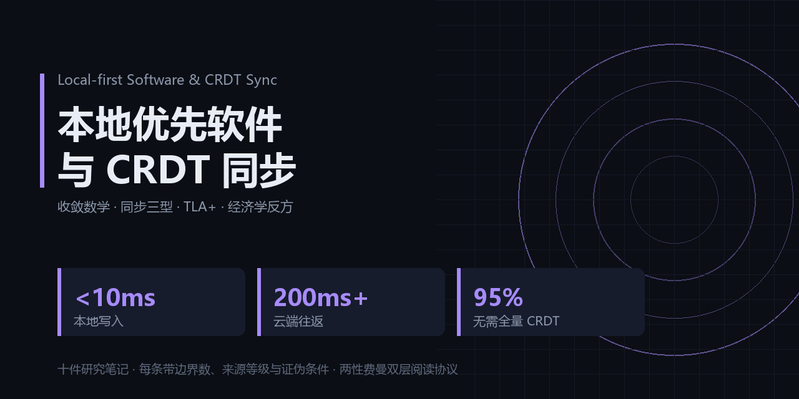

## 15 秒判断：这套笔记值不值得你收藏

**收藏它，如果你是 ——**
- 正在给离线/弱网场景的产品定同步方案、卡在「今年到底要不要上 CRDT」这一步的架构师
- 需要向法务或客户回答「主副本在哪、能不能整体导出」的医疗 / 政务 / 法律行业技术负责人
- 一人公司或小团队的技术决策者，正在算自建同步与云 SaaS 的成本账，需要一份能交给老板看的判据

**直接划走，如果你要的是 ——**
- 可直接 npm install 的同步库或能跑起来的 demo：本仓是纯研究笔记，无代码、无产品，只有判断
- 一份持续更新的生态排行榜：笔记是某一时刻的快照，项目会被收购、会停更，最近发版时间需你自己核
- 全局一致场景的落地方案：社交信息流、全球库存、千人同屏这类场景，笔记明确写了仍必须中心化云

**三条最反直觉的发现 ——**
1. 多数团队根本不需要全量 CRDT——「谁最后改的听谁的」加审计日志就覆盖了 95% 的冲突场景（95% 覆盖 [一手]，高并发行占比阈值 5% [推算]）
2. 技术更对不会自动赢：采用率是「转换成本 + 商业模式 + 网络效应」的函数，本地优先在个人资产层有确定优势，在协作网络层有结构性劣势（反方五条全部成立 [一手]，Linear / Figma 更接近离线优先云服务 [二手]）
3. 端到端加密换不来隐身：只要还与任何云端同步，元数据仍在对方视野，可实现且可证明的只有内容主权（持有 / 保护 / 可迁移三条件须同时成立 [一手]）

---

<b>English Summary</b>（英文读者展开）

These ten notes ask what actually changes when the authoritative copy of a user's data lives on their own device rather than on a server, and what that choice costs. They cover latency as an architectural signal rather than a nuisance, the algebraic laws that make conflict-free merge correct by construction, the 2026 ecosystem map, the three sync topologies that trust and availability constraints allow, formal verification entering ordinary engineering, on-device AI agents, a full section arguing the economic case against this approach, the threshold at which last-write-wins stops being sufficient, a selection decision tree, and what data sovereignty has to mean in order to be provable. Every judgment ships with a boundary number, a source grade, and an explicit condition under which it is false. They are written for engineers and researchers evaluating this field, especially teams deciding whether local-first is an architecture decision or merely a preference.

> 中文简介见下 ↓

# 本地优先软件与 CRDT 同步 · 十件研究笔记

一句话定位：这是围绕「数据主副本放在用户自己设备上」这条技术路线的一组长线研究笔记，记录十个可独立阅读、也互相引用的判断，每条都写明边界条件与证伪条件。

## 两性费曼：怎么读这套笔记

每件笔记标题之后都有两块固定结构（完整协议定义见 [FEYNMAN.md](./FEYNMAN.md)）：

- **性一（12 岁也能懂）**——这是什么 / 与我何干 / 我该怎么办。不出现未解释的术语；「与我何干」只落在 省钱、赚钱、避险、暂无 四种之一；「我该怎么办」必须是两小时内能开工的具体动作。
- **性二（同行可验证）**——机制 / 边界数 / 反例 / 可复现。边界数必须裸写来源等级 [一手] [二手] [推算]，无源数字不进正文。

建议读法：先看性一，决定值不值得读；再看性二，决定信不信；最后读正文看论证链。三处结论冲突时以正文为准——正文是唯一展开论证的地方。

两层互相制约：大众层说不清，说明作者没真懂；专业层给不出数，说明大众层只是好听。

## 十件笔记索引

| 编号 | 标题 | 一句话 | 关键边界数 | 证据等级 |
|---|---|---|---|---|
| 01 | [loading 转圈是架构失败](./notes/01-first-principles-spinner.md) | 转圈不是技术限制，是主副本被放错了地方 | 本地写 <10ms；云端 API 往返 200ms+ [一手] | 一手为主，等待时间为 [推算] |
| 02 | [CRDT 用数学保证收敛的合并](./notes/02-crdt-math.md) | 合并正确性是数据结构设计出来的，不是运行期调出来的 | 交换律 / 结合律 / 幂等律三律成立 [一手] | 一手为主，规模证据为二手 |
| 03 | [2026 生态版图](./notes/03-ecosystem-2026.md) | 从论文到固定会场，风险已从「能不能」变成「怎么选」 | Ink & Switch 2019 七准则 [一手]；FOSDEM 2026 8 小时专场 [二手] | 一手与二手混合，成熟次序判断为 [推算] |
| 04 | [同步架构三型](./notes/04-sync-architectures.md) | 传输拓扑由信任、可用性、网络三个约束穷举而成，只有三型 | 三型分类 [一手]；混合型代码量约为单架构 1.5 倍以上 [推算] | 一手为主，生产规模案例为二手 |
| 05 | [形式化验证进入工程](./notes/05-formal-verification-tla.md) | 并发顺序组合爆炸时，测试给的是样本信心，证明给的是全域保证 | SyncKit 用 TLA+ 证明同步引擎 [二手]；可证四性质 [一手] | 一手与二手混合 |
| 06 | [本地优先 × AI 设备端智能体](./notes/06-localfirst-x-ai.md) | 数据不出设备，隐私就从政策保证变成结构保证 | 首屏 bundle 数 MB [一手]；WebGPU + 量化小模型 + OPFS [二手] | 一手为主，技术栈组合为二手 |
| 07 | [经济学反方视角](./notes/07-economics-counterview.md) | 采用率是成本与商业模式的函数，不是技术优越性的函数 | 反方五条 [一手]；Linear / Figma 更接近离线优先云服务 [二手] | 一手为主，商业侧为二手 |
| 08 | [95% 定律](./notes/08-95-percent-law-lww.md) | 谁最后改的听谁的，再加一本流水账，九成五的冲突就够了 | 95% 场景可由 LWW + 审计日志覆盖 [一手]；高并发行阈值 5% [推算] | 一手为主，阈值为 [推算] |
| 09 | [选型决策树](./notes/09-decision-tree.md) | 把「要不要」从信仰问题降级成算术问题 | 四问判据（离线关键 / 数据主权 / 供应商独立 / 团队余量）[一手] | 一手为主，复审周期为 [推算] |
| 10 | [迁移思维——三层护栏 × 数据主权](./notes/10-transfer-data-sovereignty.md) | 「拥有数据」要可证，需持有、保护、可迁移三条件同时成立 | 七准则中的主权三条 [一手]；本地设备为 source of truth [一手] | 一手为主，成本对比为 [推算] |

## 这套笔记不主张什么

1. **不主张 CRDT 可以后补到 cloud-first 系统上。** 它必须从架构第一天设计；先上云、后改造的路线在笔记中被明确标红，retrofit 的成本足以让团队放弃。
2. **不主张大规模系统可以不要中心化云。** 社交信息流、全球库存、千人同屏这类需要全局一致与中心编排的场景，仍必须中心化云；本地优先止步于全局一致刚需出现的地方。
3. **不主张这条路线一定会赢。** 第 7 件整篇站在反方：订阅制商业模式、用户偏好便利、网络效应偏向大平台、不可后补的先行成本、无中心权限摩擦，五条反驳全部成立。
4. **不主张 95% 是常数。** 它是某一时刻的快照，产品从单人工具长成协作工具时会缩水，中途升级架构的代价已经写明。
5. **不主张形式化验证覆盖全部风险。** 它证的是抽象模型，覆盖「设计想错了」，不覆盖「代码写错了」；单设备无并发的场景用它属于过度投入。
6. **不主张设备端智能体能替代云端大模型。** 当下的适用面是个人工具而非大众产品；若出现只有云端能做、用户又天天要用的场景，这条判断即失效。
7. **不主张数据主权等于行为隐身。** 只要还与任何云端服务同步，元数据仍在对方视野里；可实现、可证明的是内容主权。
8. **不主张这套版图可以一次认知用三年。** 项目会被收购、会停更，收购后路线可能转向云优先；「最近一次发版时间」与「数据能否整体导出」应常驻选型表第一行。
9. **不主张本地优先在所有层都占优。** 结论是分层的：个人资产层有确定优势，协作网络层有结构性劣势，混合架构是多数真实产品的答案。

## 证据纪律

- 每个数字必须标来源等级：[一手] 原始论文 / 官方文档 / 实测；[二手] 综述、报道、转述；[推算] 由已知数推导。无源数字不得进入对外文本。
- 估算必须就地写明是估算，不得混入事实陈述。
- 每条结论配反例与证伪条件。写不出反例的判断，不写。
- 引用具体产品与项目时用中性表述，不做优劣排序，不以名气或流行度作为论据。
- 只保留称谓，不出现真实姓名、邮箱与任何隐私信息。
- 被推翻是预期内的正常结果，不是失败；结论被证伪时改写结论，而不是删掉证伪条件。

## 许可

MIT License。作者署名：chenhz01。

## 同系列笔记（五个领域）

| 领域 | 仓库 | 一句话 |
|---|---|---|
| 神经形态计算与事件驱动传感 | [neuromorphic-event-sensing](https://github.com/chenhz01/neuromorphic-event-sensing) | 永远在线的智能为什么必须抛弃「帧」与全局时钟，以及省 100 倍的前提条件 |
| AI 老药新用与计算重定位 | [ai-drug-repurposing](https://github.com/chenhz01/ai-drug-repurposing) | 用计算手段给已上市分子找新适应症，以及 10-30% 的前瞻重复率边界 |
| 本地优先软件与 CRDT 同步 | [local-first-crdt](https://github.com/chenhz01/local-first-crdt) | 把数据主副本放回用户设备，冲突由数学保证收敛 |
| 后量子密码迁移 | [post-quantum-migration](https://github.com/chenhz01/post-quantum-migration) | 从 Shor 的威胁模型走到一人公司能执行的换算法顺序 |
| 软体与折纸机器人 | [soft-origami-robotics](https://github.com/chenhz01/soft-origami-robotics) | 柔性结构能否把安全、顺应与几何编程做成工程能力 |

五套笔记各自独立，互不依赖，可任选入口进入。

## 费曼速览：60 秒判断这个领域值不值得你花时间

**一句话**：像把作业本放进自己的书包而不是锁在讲台抽屉里——想改就改，不用举手等老师递回来；哪里不像：书包里的本子借给同学同时改，两人改到同一行时得有规则决定听谁的，而这套规则（CRDT）必须从架构第一天就设计进去，后补的代价足以让团队放弃。

**三个数**：

1. 本地写 <10ms，云端 API 往返 200ms+ [一手]
2. 95% 的冲突场景可由 last-write-wins + 审计日志覆盖 [一手]
3. 高并发行占比阈值 5%，低于此值多数团队今年不需要全量 CRDT [推算]

**不成立的三个条件**：

1. 若你的产品需要全局一致与中心编排（社交信息流、全球库存、千人同屏），本地优先止步于此，中心化云仍是唯一答案。
2. 若产品从单人工具长成协作工具，「95% 可由 LWW 覆盖」会明显缩水，本套笔记的层级选择结论失效。
3. 若 CRDT 被证明可以低成本后补到 cloud-first 系统上，则「必须从架构第一天设计、retrofit 不划算」这条判断不成立。

这套笔记的每篇都有完整两层费曼拆解，方法见 [FEYNMAN.md](./FEYNMAN.md)。

## 可引用卡片：想转给同事，直接复制这几句

> 转圈不是网速问题，是主副本放错了地方：本地写小于 10ms，云端往返 200ms 以上。
> —— 出自《loading 转圈是架构失败》，[查看原文](./notes/01-first-principles-spinner.md)

> 95% 的冲突不需要 CRDT，谁最后改的听谁的，再加一本不可变流水账就够了。
> —— 出自《95% 定律》，[查看原文](./notes/08-95-percent-law-lww.md)

> 端到端加密换不来隐身：只要还在同步，元数据仍在对方视野，能证明的只有内容主权。
> —— 出自《迁移思维——三层护栏 × 数据主权》，[查看原文](./notes/10-transfer-data-sovereignty.md)

每句都自带出处链接，可单独复制转发。
